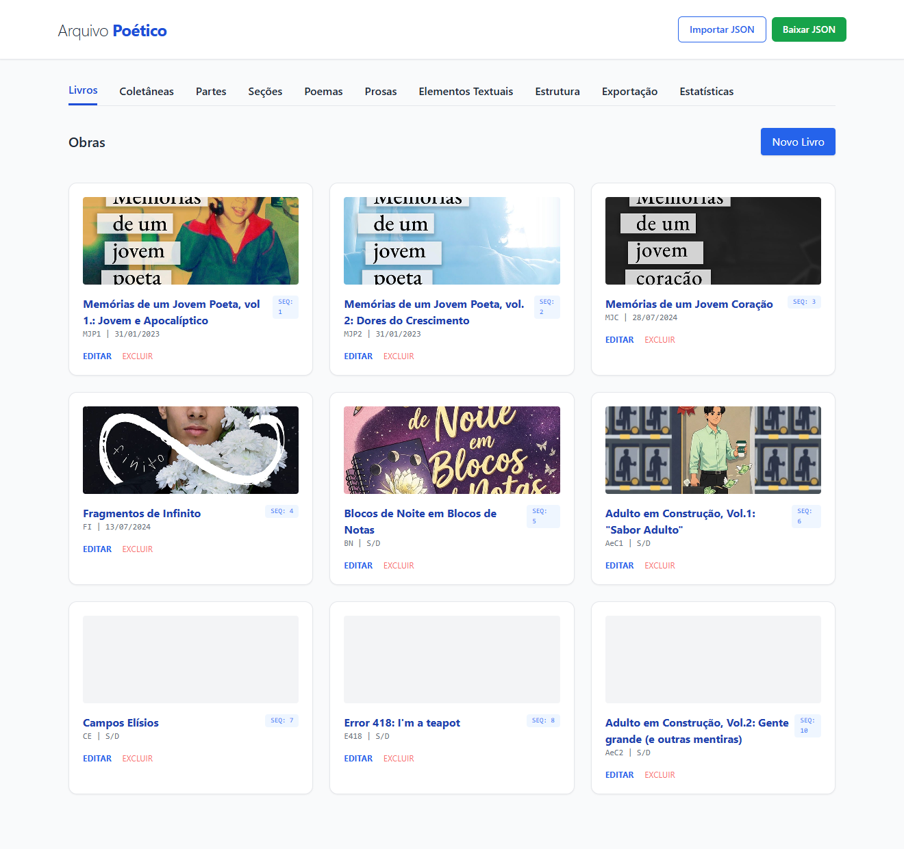
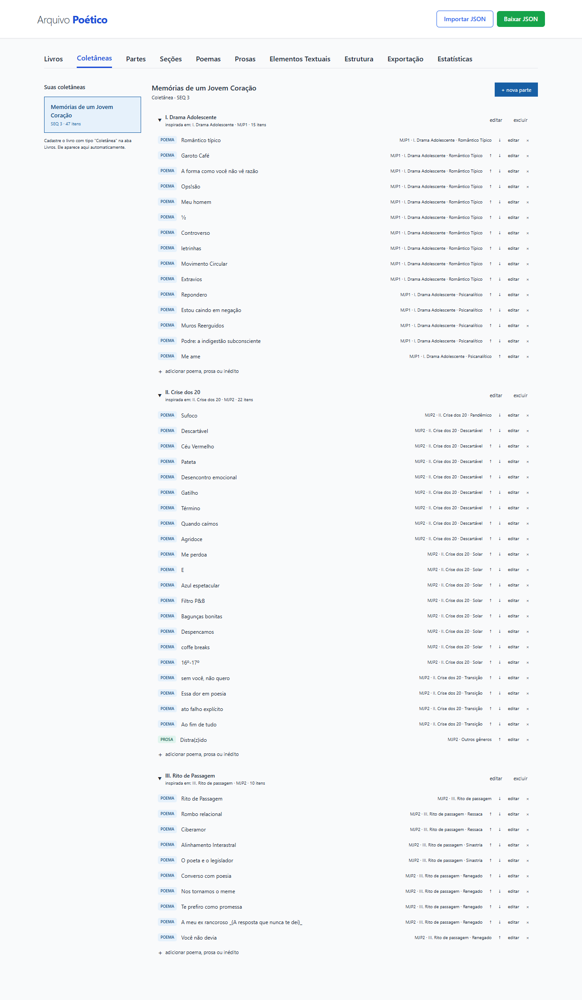
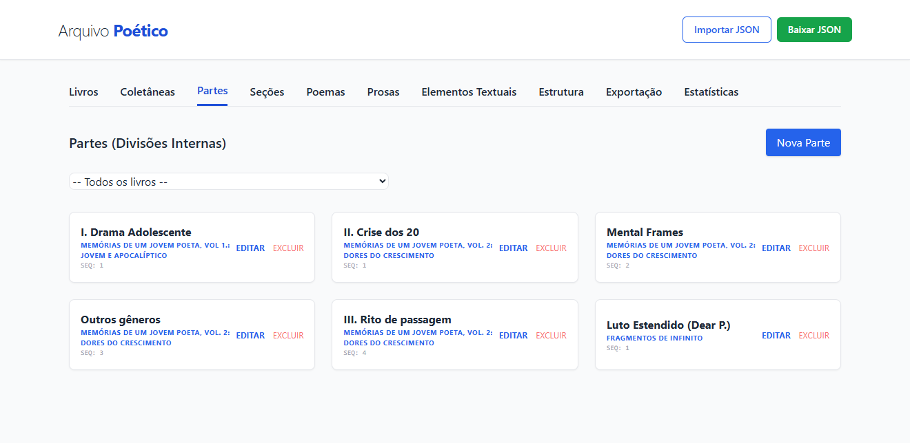
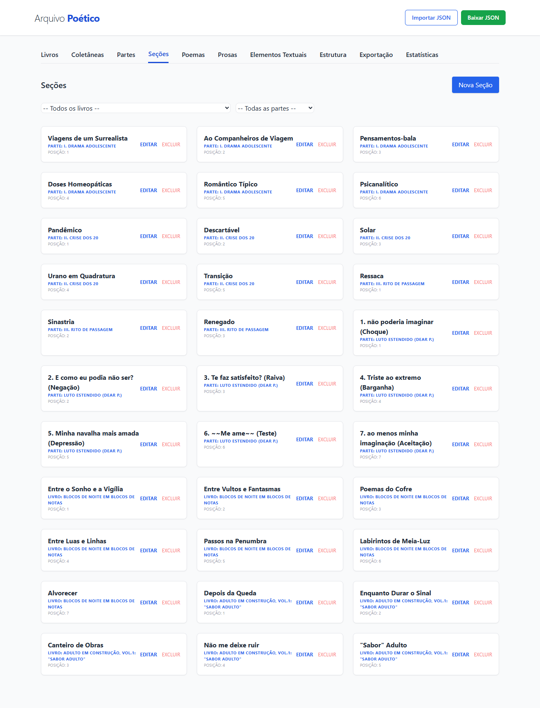
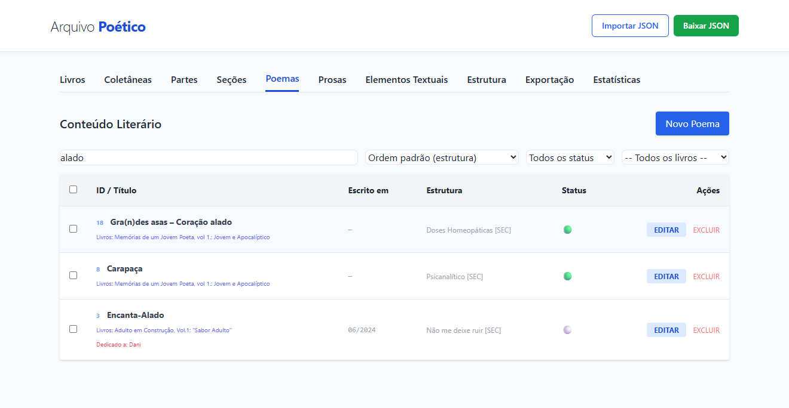
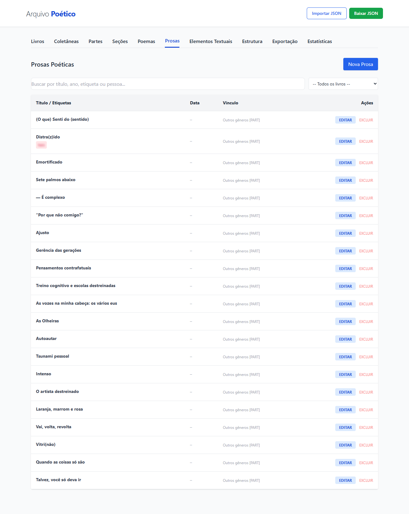
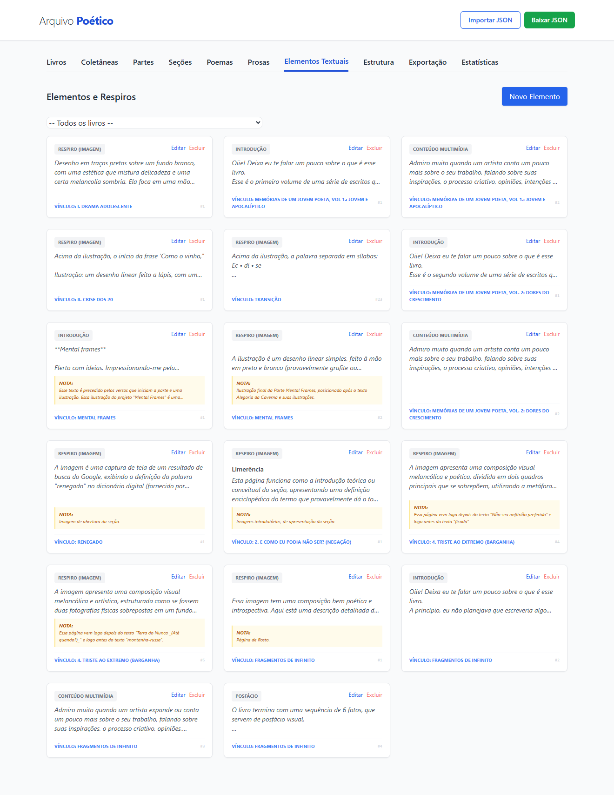
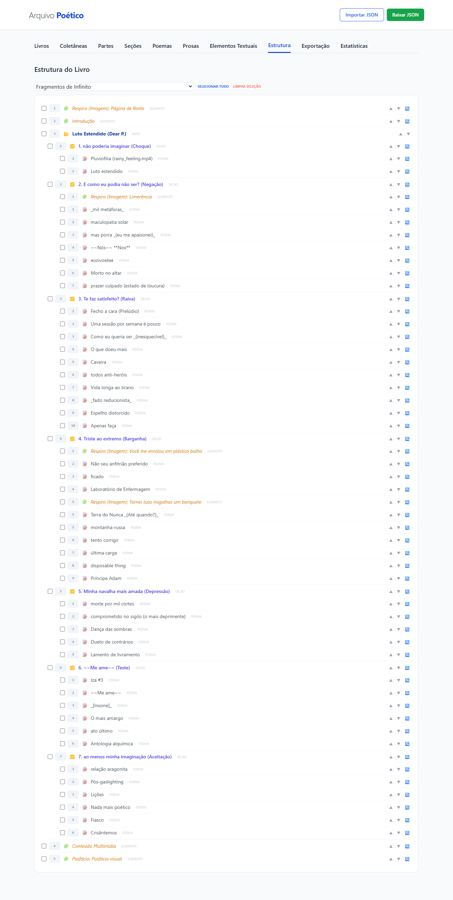
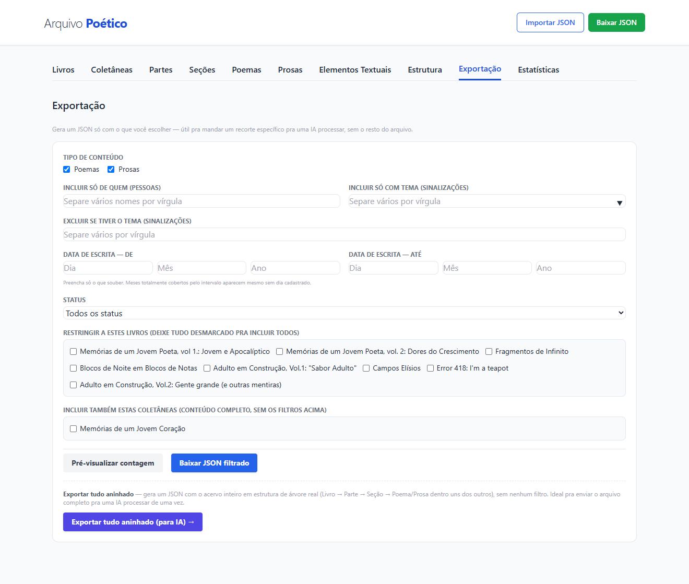
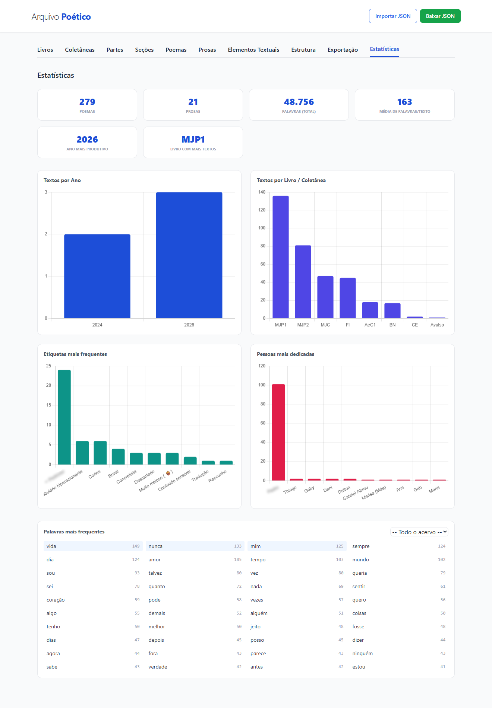

# Arquivo Poético

🌐 **Idioma:** [English](README.md) | **Português** (você está aqui)

Aplicativo local (sem backend) para organizar, editar e exportar um acervo de
poemas, prosas, livros e coletâneas. Tudo roda no navegador; os dados textuais
ficam salvos em `localStorage` e as capas (imagens) em `IndexedDB`. Os arquivos
`.json` são usados para backup e troca de dados — o backup completo pode
embutir as capas como base64 (checkbox "capas" ao lado de "Baixar JSON"), mas
as exportações seletivas nunca incluem imagens.

---

## Como rodar

O app usa ES Modules, então **não funciona abrindo o `index.html` diretamente**
pelo sistema de arquivos (restrição de CORS do navegador). É preciso um servidor
local estático:

- **VS Code:** instale a extensão [Five Server](https://marketplace.visualstudio.com/items?itemName=yandeu.five-server) ou Live Server e clique em "Go Live"
- **Python:** `python -m http.server` na pasta do projeto, depois acesse `http://localhost:8000`
- **Node:** `npx serve .` na pasta do projeto

Nenhuma dependência precisa ser instalada pra usar o app. O Tailwind CSS é carregado via CDN; Chart.js e DOMPurify são vendorizados localmente em `assets/js/`.

### Suíte de testes

Pra desenvolvimento (não necessário só pra usar o app), instale as dependências e rode a suíte com o executor de testes nativo do Node:

```
npm install
npm test         # node --test (tests/)
npm run lint     # eslint .
npm run format:check   # prettier --check .
```

---

## Capturas de tela

### Livros



### Coletâneas



### Partes



### Seções



### Poemas



### Prosas



### Elementos



### Estrutura



### Exportar



### Estatísticas



---

## Estrutura de pastas

```
/
├── index.html               → Esqueleto do app: header, nav, abas e #modais-container
├── filtrar.html              → Ferramenta separada para cadastrar versões alternativas
│                                de textos sensíveis antes de exportar para uma IA
│                                (ver seção "Versões Alternativas" abaixo)
├── localizar-substituir.html → Ferramenta separada de busca e substituição de
│                                trechos em Poemas/Prosas (ver "Funcionalidades
│                                principais" abaixo)
├── README.md
├── README.pt-br.md
├── CONTRIBUTING.md / CONTRIBUTING.pt-br.md
├── CLAUDE.md                 → Instruções para o Claude (regras de trabalho e mapa dos
│                                arquivos de manutenção e planejamento)
├── LICENSE
├── package.json / package-lock.json  → Scripts (`npm test`, `npm run lint`,
│                                        `npm run format`) e dependências de
│                                        desenvolvimento (docx, eslint, happy-dom,
│                                        jszip, prettier — ver "Suíte de testes"
│                                        abaixo)
├── eslint.config.js / .prettierrc.json / .prettierignore
│
├── assets/
│   ├── css/
│   │   └── style.css        → Estilos complementares ao Tailwind (CDN)
│   ├── icons/
│   │   └── favicon.svg, favicon-32.png, favicon-180.png
│   ├── logo/
│   │   └── Logo.png, Logo.ai, Logo (variacoes).png, Logo (com margem).png
│   └── screenshots/         → Capturas de tela para o README
│
├── docs/                      → Guias de uso com IAs externas (ChatGPT, Claude,
│   │                            Gemini etc.), fora do fluxo de decisões de
│   │                            desenvolvimento (ver "manutencao/" abaixo)
│   ├── campos-poema-prosa-for-ai.md / campos-poema-prosa-for-ai-pt-br.md
│   │                          → Mapa de todos os campos de um registro de
│   │                            Poema/Prosa, pra quem for ler dados exportados
│   │                            sem abrir o código
│   ├── etiquetas-sinalizacoes-for-ai.md / etiquetas-sinalizacoes-for-ai-pt-br.md
│   │                          → Lógica das etiquetas do acervo ("Etiquetas"
│   │                            na interface; antes "Sinalizações") — que categoria cada uma
│   │                            representa, e como são guardadas (cadastro com ids) e
│   │                            exportadas (nomes)
│   ├── export-to-ia.md / export-to-ia-pt-br.md
│   │                          → Formato aninhado vs. flat na exportação do
│   │                            acervo para uso com IA (ver "Funcionalidades
│   │                            principais")
│   ├── importar-campos-for-ai.md / importar-campos-for-ai-pt-br.md
│   │                          → Formato do arquivo de "Importar campos" (soma
│   │                            etiquetas, temas, assuntos, locais, pessoas e campos
│   │                            simples a textos que já existem, por um .json que
│   │                            uma IA pode montar)
│   ├── intratextualidade-for-ai.md / intratextualidade-for-ai-pt-br.md
│   │                          → Elos e Ecos (Intratextualidade): como se
│   │                            diferenciam, como escolher Relação, Direção e
│   │                            Tipo, e como não confundi-los com campos vizinhos
│   ├── morfofuncionalidade-for-ai.md / morfofuncionalidade-for-ai-pt-br.md
│   │                          → Campos do registro de Morfofuncionalidade
│   │                            (Unidades/Eventos, posição no texto,
│   │                            Templates) — aba "Morfofuncionalidade"
│   ├── pessoas-papeis-for-ai.md / pessoas-papeis-for-ai-pt-br.md
│   │                          → Lógica do campo `pessoas` de Poemas/Prosas —
│   │                            papéis atribuídos a cada pessoa citada
│   ├── personagens-for-ai.md / personagens-for-ai-pt-br.md
│   │                          → Lógica do campo `personagens` em
│   │                            Poemas/Prosas e do cadastro de
│   │                            Personagem (papéis, centralidade,
│   │                            relação com texto e livro)
│   ├── scansion-for-ai.md / scansion-for-ai-pt-br.md
│   │                          → Instrui uma IA a escandir um poema colado
│   │                            (grade silábica, tônicas, pares de rima e os 7
│   │                            campos de classificação da aba Sonoridade),
│   │                            pronto pra transcrever a resposta pro sistema
│   ├── sonoridade-for-ai.md / sonoridade-for-ai-pt-br.md
│   │                          → Campos do registro de Sonoridade
│   │                            (classificação geral, grade silábica, rimas e
│   │                            ecos) — complementar a scansion-for-ai.md
│   ├── temas-assuntos-for-ai.md / temas-assuntos-for-ai-pt-br.md
│   │                          → Temas e Assuntos: como se ligam, papéis,
│   │                            nomes e critérios de escolha (o critério por
│   │                            trás do "Importar campos")
│   └── transtextualidade-referencias-for-ai.md / transtextualidade-referencias-for-ai-pt-br.md
│                              → Os três campos do grupo "Transtextualidade e
│                                Referências (Externas)": Intertextualidade,
│                                Hipertextualidade e Referências
│
├── manutencao/                → Documentação interna de desenvolvimento (não é
│   │                            guia de uso do app — ver "docs/" acima)
│   ├── status.md              → "Estado atual" no topo; abaixo, histórico do que
│   │                            foi fechado e roteiros de conferência no navegador
│   ├── schema.md              → Detalhamento de cada campo do modelo de dados
│   ├── decisoes.md            → Porquês de decisões de produto/schema
│   ├── licoes-de-sessao.md    → Riscos e armadilhas conhecidas ao retomar
│   │                            uma sessão de desenvolvimento
│   ├── criacao-molde.md       → Desenho da aba Criação (Moldes)
│   └── progressao-morfofuncional.md → Desenho da Progressão Morfofuncional
│
├── planejamento/              → Plano central das fases, plano da fase em
│                                andamento e ideias ainda sem fase
│
├── js/                       → Toda a lógica do app (ES Modules)
│   ├── main.js               → Ponto de entrada; liga os onclick="" do HTML às
│   │                           funções e registra cada modal (id, arquivo, init)
│   ├── db.js                 → Estado central + persistência (localStorage)
│   ├── capas.js              → Armazenamento de imagens de capa via IndexedDB;
│   │                           redimensiona e comprime automaticamente no upload
│   ├── modais.js             → Carregamento lazy dos modais via fetch, com cache
│   ├── ui.js                 → Abas, dropdowns, auto-preenchimento (reexporta
│   │                           toggleModal/garantirModal de modais.js)
│   ├── render.js             → Orquestrador: chama, em ordem, os renderers
│   │                           de cada aba a cada 'db:saved' (ver os
│   │                           módulos abaixo pra lógica de cada um)
│   ├── render-listas.js      → Renderização de Livros/Partes/Seções/
│   │                           Poemas (+ seleção múltipla)/Prosas/Elementos/
│   │                           Pessoas/Grupos/Autores/Épocas/Sonoridade
│   ├── render-estrutura.js   → Árvore da aba "Estrutura": seleção em
│   │                           cascata, mover ▲▼, mover entre níveis
│   ├── render-conexoes.js    → Aba "Conexões": monta os diagramas de Elos
│   │                           (pares/clusters) e Referências (grafo em
│   │                           camadas) a partir de db.poemas/db.prosas,
│   │                           mais o painel de "buracos"
│   ├── exportar-conexoes.js  → Relatório das Conexões em .md (lógica pura:
│   │                           escopos todas/elos/ecos/seleção, resumo) e o
│   │                           download
│   ├── exportar-conexoes-png.js → Relatório das Conexões desenhado num SVG só
│   │                           (cartões para Elos, diagramas para Ecos),
│   │                           usado pelo .png e pelo .pdf
│   ├── exportar-conexoes-pdf.js → Fatia esse desenho em páginas A4 (quebra só
│   │                           entre blocos, "n / total")
│   ├── selecao-conexoes.js   → Modo Selecionar da aba Conexões: chave estável
│   │                           por buraco/Elo/Eco e o filtro de "Só
│   │                           selecionados"
│   ├── render-lightbox.js    → Carrega capas do IndexedDB de forma
│   │                           assíncrona e exibe lightbox navegável
│   ├── autobackup.js         → Snapshots automáticos do acervo no
│   │                           IndexedDB (rede de segurança além do
│   │                           "Baixar JSON" manual — não substitui)
│   ├── inventario-armazenamento.js → Inventário de tudo que o app guarda no
│   │                           navegador, classificado (dado / preferência)
│   ├── esvaziar-acervo.js    → Lógica pura do "Esvaziar o acervo": o que cada
│   │                           caixa tira, resumo, plano de armazenamento
│   ├── ui-esvaziar-acervo.js → A janela: resumo, backup, retrato, palavra
│   ├── apagar-acervo.js      → O apagar efetivo: grava o acervo esvaziado,
│   │                           capas, chaves, avisa outras abas e recarrega
│   ├── forms.js              → Submit/edição de Livro, Parte, Seção, Poema,
│   │                           Prosa, Elemento, Pessoa, Grupo, Autor, Época
│   │                           (inclui o fluxo de Mesclar Pessoa/Época e a
│   │                           cascata da Matriz de Validação de Sonoridade)
│   ├── editor.js             → Toolbar de formatação do texto + tags/pessoas
│   ├── editor-sonoridade.js  → Aba Sonoridade: grade silábica, Modo Sílaba
│   │                           Tônica, Modo Rima, mapeamento/classificação de
│   │                           pares de rima e a grade somente-leitura
│   │                           reaproveitada pelo modal "Ver"
│   ├── visualizar-livro.js     → Modal "Ver" do Livro (somente leitura, com anterior/próximo)
│   ├── visualizar-sonoridade.js → Modal "Ver" de uma escansão (somente
│   │                           leitura, mesma grade de editor-sonoridade.js)
│   ├── exportar-sonoridade.js → Exportação de uma escansão em .md/.pdf/.docx/
│   │                           .json — Grade Silábica em tabela real no .pdf/
│   │                           .docx (com paisagem automática em versos longos
│   │                           no .pdf), texto linear com " / " no .md
│   ├── coletaneas.js         → Lógica da aba de Coletâneas
│   ├── colunas.js            → Colunas visíveis e sua ordem nas tabelas de
│   │                           Poemas/Prosas (preferência por tabela, salva
│   │                           no localStorage)
│   ├── colunas-contagem.js   → Colunas de "quantidade de valores" com filtro
│   │                           numérico opcional, nas tabelas de
│   │                           Poemas/Prosas/Sonoridade — registro de campos
│   │                           contáveis por tabela (`registroContavel`)
│   ├── celulas-tabela.js     → Cabeçalho ordenável, paginação e seleção em
│   │                           massa das tabelas de Poemas/Prosas
│   ├── selecao-massa.js      → Barra de ações em massa (exportar seleção em
│   │                           JSON/Markdown) nas listagens de Poemas/Prosas
│   ├── acoes-coluna.js       → Botões visíveis na coluna Ações (Ver, Baixar,
│   │                           Editar, Excluir) e formato usado por "Baixar",
│   │                           nas tabelas de Poemas/Prosas/Sonoridade
│   ├── busca-campo.js        → Ctrl+F restrito a um campo de texto
│   │                           específico, em vez do Ctrl+F nativo do
│   │                           navegador (busca a página inteira)
│   ├── visualizar.js         → Modal "Ver" de Poema/Prosa: mostra o mesmo
│   │                           conteúdo do `.md` exportado, renderizado na tela
│   ├── theme.js              → Tema claro/escuro/automático (reage a
│   │                           mudança do tema do sistema operacional)
│   ├── estatisticas.js       → Painel de estatísticas (Chart.js)
│   ├── exportar.js           → Exportação seletiva (por atributos) + exportação
│   │                           da seleção nas listagens de Poemas/Prosas +
│   │                           exportações aninhadas completas
│   ├── exportar-md.js        → Geração do formato Markdown (usado pela
│   │                           Exportação seletiva, seleção da tabela e
│   │                           exportações aninhadas)
│   ├── exportar-pdf.js       → Geração do formato PDF (coluna Ações e
│   │                           modal Ver de Poema/Prosa)
│   ├── exportar-docx.js      → Geração do formato Word (.docx) de Poema/Prosa
│   │                           e da própria escansão de Sonoridade
│   ├── exportar-frequentes.js → Aba "Exportações Frequentes" (dentro do menu
│   │                           Exportação): os 6 downloads fixos (Backup,
│   │                           Aninhado, Flat e Filtrado em JSON/MD) com nome
│   │                           de arquivo configurável, mais templates de
│   │                           filtro salvos (Pessoa/Etiqueta por
│   │                           categoria/Gênero, combináveis com "E" lógico).
│   │                           Baixar em lote gera um único `.zip` (JSZip) ou
│   │                           downloads separados, à escolha da pessoa
│   ├── nesting.js            → Lógica de encadeamento hierárquico (usada por
│   │                           exportar.js)
│   ├── Demais módulos, agrupados por assunto (o nome de cada arquivo diz o
│   │   que ele faz; o cabeçalho de cada um explica em detalhe):
│   │   · Cadastros: temas.js, etiquetas.js, tag-clusters*.js, locais.js, regiao.js, personagens.js,
│   │     correntes-hierarquia.js, periodos-*-hierarquia.js,
│   │     periodo-biografico-*.js, periodo-historico-*.js,
│   │     periodos-historicos-campos.js, fontes-corrente*.js,
│   │     fontes-periodo-historico*.js, pessoas-viagem.js
│   │   · Edição em massa: selecao-massa.js, massa-valores.js,
│   │     campo-etiquetas-massa.js, campos-preenchiveis.js, *-massa.js e
│   │     *-acoes.js (uma dupla por aba)
│   │   · Âncora e sugestão de Ecos: alvos-conceitos.js, ancora-eco*.js,
│   │     sugestao-ecos.js, ui-sugestao-ecos.js, grupo-personagens.js
│   │   · Estatísticas: estatisticas-dados*.js (agregações),
│   │     estatisticas-tela-*.js (uma tela por aba), estatisticas-filtros.js
│   │   · Exportação, importação e backup: exportar-csv.js, exportar-assuntos.js, exportar-tag-clusters.js, exportar-tag-clusters-png.js (o desenho do .png e do .pdf), selecao-tag-clusters.js, rasterizar-svg.js, importar-tag-clusters.js,
│   │     exportar-autores.js, exportar-estrutura-textual.js,
│   │     ocultos-exportacao.js, download-abrangente.js, importar-aditivo.js,
│   │     ui-importar-aditivo.js, importar-campos.js, importar-campos-extras.js,
│   │     modelo-importar-campos.js, ui-importar-campos.js, importar-sonoridade.js, extras-backup.js,
│   │     ui-extras-backup.js, pacote-texto.js, ui-biblioteca*.js
│   │   · Visualização: visualizar-*.js (Autor, Grupo, Correntes, Períodos,
│   │     Estrutura textual), lista-textos-periodo.js, faixa-origem.js
│   │   · Criação e Morfofuncionalidade: editor-molde.js, molde-json.js,
│   │     ui-molde-json.js, estrutura-textual.js
│   │   · Ajuda: modo-aprendizado.js, tour*.js, central-ajuda.js,
│   │     faq-conteudo.js, como-faco-passos.js
│   │   · Outros: fuso-horario.js, ocultas-periodos.js
│   └── utils.js              → Funções puras sem dependências internas;
│                               inclui modal de confirmação de exclusão,
│                               geração de ID (gerarId), escaping de HTML
│                               (escapeHtml) e as constantes/matriz de
│                               validação em cascata da aba Sonoridade
│
├── modais/                    → HTML de cada modal, carregado sob demanda
│   ├── modal-livro.html
│   ├── modal-parte.html
│   ├── modal-secao.html
│   ├── modal-poema.html
│   ├── modal-prosa.html
│   ├── modal-elemento.html
│   ├── modal-col-parte.html
│   ├── modal-col-item.html
│   ├── modal-pessoa.html
│   ├── modal-grupo.html
│   ├── modal-autor.html
│   ├── modal-epoca.html
│   ├── modal-sonoridade.html  → Cadastro/edição de uma escansão (ver
│   │                            editor-sonoridade.js)
│   ├── modal-visualizar-sonoridade.html → Modal "Ver" de uma escansão (ver
│   │                            visualizar-sonoridade.js)
│   ├── modal-visualizar.html  → Modal "Ver" de Poema/Prosa (ver visualizar.js)
│   ├── (demais modais) Assunto, Tema, Local, Personagem, Período Histórico,
│   │   Correntes (Movimento/Escola), opções de Períodos, Molde,
│   │   Morfofuncionalidade, Template de estrutura, Sugestão de Ecos,
│   │   Esvaziar acervo, Central de Ajuda, Modo Aprendizado e os modais
│   │   "Ver" de Autor, Grupo, Correntes, Períodos e Estrutura textual
│   └── modal-mesclar.html     → Modal genérico de Mesclar (Pessoa/Época)
│
├── scripts/
│   ├── montar-pacote.js       → Gera os pacotes da Biblioteca (biblioteca/*.json)
│   │                            a partir de biblioteca/fontes/
│   └── normalizar-datas.js    → Script de manutenção pontual de dados (datas)
│
├── biblioteca/                → Pacotes de textos em domínio público (um .json por
│   │                            autor, mais indice.json), gerados por montar-pacote.js
│   └── fontes/                → Fonte de cada pacote (.md + .meta.json)
│
├── prototipos/                → Páginas soltas, fora do app (ex.: cifra-minima.html)
│
├── tests/                     → `node --test` (ver "Suíte de testes" abaixo)
│   └── helpers/
│
└── data/                      → Excluída do controle de versão (ver .gitignore);
                                  backups pessoais e exportações ficam aqui
```

---

## Funcionalidades principais

- **Cadastro hierárquico**: Livros → Partes → Seções, com Poemas, Prosas e
  Elementos Textuais (introdução, multimídia, comentário, respiro, posfácio)
  podendo se vincular a qualquer um desses três níveis. Veja
  `docs/campos-poema-prosa-for-ai-pt-br.md` para o mapa completo de campos
  de um registro de Poema/Prosa.
- **Coletâneas**: aba separada para montar curadorias. Uma Coletânea é um
  registro em `db.livros` com `tipo: "Coletânea"`; ela tem Partes (mesma
  coleção `db.partes` das Partes normais, distinguidas pelo `livroId`) e cada
  Parte tem Itens em `db.itensColetanea` (vinculados por `parteId`), que
  referenciam poemas/prosas já existentes (`refId`/`refTipo`) ou são textos
  exclusivos da coletânea (`textoOverride`). Excluir uma coletânea remove em
  cascata suas partes e itens, sem afetar os textos originais.
- **Capas**: Livros, Partes e Seções aceitam uma imagem de capa. As imagens
  são armazenadas em `IndexedDB` e nunca entram no JSON de backup. O lightbox
  de visualização suporta navegação entre capas com ◀ ▶ e teclas ← →.
- **Datas parciais**: Data de Escrita e Data de Primeira Publicação aceitam
  dia/mês/ano/hora/minuto parciais — preencha só o que souber.
- **Editor de texto rico**: negrito, itálico, sublinhado, alinhamento, cor,
  fonte e tamanho aplicados inline ao texto do poema.
- **Cadastros centrais** (abas Pessoas, Grupos, Autores, Épocas): registros
  próprios reutilizáveis em vez de texto solto. Em cada Poema/Prosa, uma
  Pessoa pode ter um ou mais papéis (`PAPEIS_PESSOA`: Retratado(a),
  Inspiração para, Dedicatário(a), Mencionado(a), Aludido(a), Associado(a)
  retroativamente) e um Grupo
  pode ser referenciado diretamente (sem citar uma Pessoa específica dele) ou
  via uma Pessoa vinculada a ele. Autoria usa um papel único por texto
  (Autor/Coautor). Renomear uma Pessoa ou Época para um nome já existente
  não funde os registros automaticamente — o formulário oferece **Mesclar
  agora** (une os dois, movendo vínculos), **Salvar mesmo assim** (mantém
  os dois separados) ou **Cancelar**. Veja `docs/pessoas-papeis-for-ai-pt-br.md`
  para a lógica completa dos papéis atribuídos a cada Pessoa.
- **Tags e pessoas**: etiquetas (por categoria) e "dedicado a / sobre quem" como
  etiquetas reutilizáveis, com sugestão por `<datalist>`. Veja
  `docs/etiquetas-sinalizacoes-for-ai-pt-br.md` para a lógica completa de
  cada categoria de etiqueta.
- **Períodos Biográficos** (antes "Épocas"): cadastro próprio (`db.epocas`) com
  início/fim (datas parciais, "em andamento"), Esfera, Categoria, pessoas
  envolvidas e relações entre elas (Natureza e Vínculo), "Faz parte de"
  hierárquico, marca de evento e opção de ocultar. Um Poema/Prosa referencia
  um ou mais períodos, cada um com `recorte` — "momento" (só o evento) ou
  "repercussão" (o efeito depois).
- **Períodos Históricos**: períodos de fábrica mais os criados por você, com
  hierarquia ("Faz parte de"), Esfera e Categoria (vocabulário próprio e
  editável), Região, fontes e marca de evento. Nos textos, Esfera e Categoria
  aparecem como colunas e buscas derivadas.
- **Correntes literárias** (antes Movimento/Escola): cadastro hierárquico com
  Tipo, Programa, Postura estética, divisões (fase, geração, vertente,
  variante regional), Região de origem, Valores, Temas, Técnicas, Tipos de
  composição, Lemas, Manifestos e fontes; vem com correntes de fábrica.
- **Temas e Assuntos**: o Tema é um cadastro central, com papel (principal,
  secundário ou indefinido) em cada texto, agrupado em Assuntos; sugere
  duplicatas e mescla com Desfazer.
- **Locais**: cadastro hierárquico (um Local pode ter vários pais), usado em
  Territorialidade e em "Local onde foi escrito", no grupo "Região e Idioma"
  do modal, ao lado do Idioma (com papel e dialeto).
- **Personagens**: cadastro central com papéis e centralidade em cada texto,
  participação por livro e âncora opcional nos Ecos; sugestão de Ecos
  faltantes sob demanda. Ver `docs/personagens-for-ai-pt-br.md`.
- **Edição em massa**: Poemas, Prosas, Pessoas, Períodos Biográficos, Períodos
  Históricos e Correntes têm seleção por cartão ou linha e uma barra de ação
  (Acrescentar, Remover, Definir ou Limpar, conforme o campo), sempre com
  **Desfazer**. Campos de lista usam etiquetas, como nos modais.
- **Estatísticas**: várias abas, entre elas Cruzamentos (matriz de Temas por
  Pessoas ou Grupos), Local e idioma, Correntes literárias e Personagens;
  clicar numa barra abre a lista de textos correspondente.
- **Dados**: aba Biblioteca (pacotes de textos em domínio público para
  importar), Importação Aditiva (soma ao acervo sem apagar nada) e Backup e
  recuperação (retratos automáticos, arquivo de extras e **Esvaziar o acervo**,
  com backup obrigatório e palavra de confirmação).
- **Criação (Moldes)**: grade de versos orientada por uma meta estrutural
  (forma, rimas), com pareamento de rimas e promoção do Molde a Poema; um Molde
  pode ser exportado e importado em JSON.
- **Modo Aprendizado e Central de Ajuda**: tour guiado do app, perguntas
  frequentes e roteiros "Como eu faço para...".
- **Status do Poema**: 🟡 Incompleto, ⚪ Completo, 🟢 Publicado, 🔵 Migrado
  (texto movido de um livro/seção para outro), 🔴 Descartado e 🔒 Privado
  (nunca teve intenção de publicação, diferente de Descartado).
- **Migração entre livros** (Poema): campos "Cortado de" e "Lançado em"
  (Livro + Parte/Seção), texto livre com sugestão por `<datalist>` dos
  livros/partes/seções já cadastrados — pensados para poemas com status
  Migrado, mas preenchíveis a qualquer momento (o livro de origem pode nem
  existir mais como registro no arquivo). Escolher uma Seção já cadastrada
  preenche o Livro correspondente sozinho; digitar/escolher o Livro filtra
  as sugestões de Seção só às daquele livro.
- **Elos e Referências** (Poema e Prosa): dois jeitos de ligar um texto a
  outro do próprio acervo (Prosa pode apontar para Poema ou Prosa; Poema só
  para outro Poema). **Elos** são bilaterais — uma `relacao` (Reescrita,
  Continuidade, Tradução, Variação, Versão, Resposta, Díptico, Outro) com
  `direcao` (origem = texto base, destino = texto derivado). **Referências**
  são unidirecionais, sempre do texto mais novo para o mais antigo — só
  `tipo` (Personagem em comum, Imagem central compartilhada, Aceno a,
  Outro), sem direção. A aba **Conexões** varre todos os Elos/Referências e
  monta diagramas de grafo (pares/clusters para Elos, camadas para
  Referências — convergências e ramificações viram nós únicos com várias
  arestas, não nós duplicados) e um painel de "buracos" (elo cadastrado só
  de um lado); cada diagrama pode ser baixado como PNG. A aba também baixa
  um **relatório** (todas as conexões, só Elos ou só Referências, que na tela se chamam Elos e Ecos) em `.md`
  (texto simples, bom para colar numa IA), `.png` ou `.pdf` (os dois com os
  desenhos; o PDF é imagem, então o texto dele não é pesquisável). Um modo
  **Selecionar** põe uma caixinha em cada buraco, Elo e Referência para
  baixar só os selecionados (`conexoes-selecao.*`). Os títulos de Elos e
  Referências abrem o modal **Ver**, e os buracos abrem o editor; no editor
  de Poema, um botão de olho no cabeçalho passa para o Ver do mesmo poema
  (perguntando "Salvar antes de ver?" quando há alteração não salva).
- **Envios e Reações** (Poema e Prosa): registro de quando e para quem um
  texto foi enviado (pessoa, data, meio, reação, notas) — `pessoa` e `meio`
  são texto livre com sugestão por `<datalist>`, sem exigir cadastro central.
- **Reconhecimentos** (Poema e Prosa): prêmios ou menções recebidos por um
  texto (nome do prêmio, posição, ano, notas).
- **Status editorial de Livros/Coletâneas**: Inédito, Esgotado, Domínio
  público ou Reeditado — conceito de publicação do livro como um todo,
  separado do Status do Poema/Prosa individual.
- **Intertextualidade** (Poema e Prosa): lista de referências externas
  (música, livro, filme/série, vídeo, citação...), cada uma com tipo +
  texto — um texto pode dialogar com várias referências de tipos
  diferentes ao mesmo tempo. Cada item pode ser editado in-place (clique
  em ✎ pra reabrir um item já salvo antes de excluí-lo).
- **Hipertextualidade** (Poema e Prosa): lista de transformações diretas
  de uma obra de origem específica — tipo (mesmas sugestões de
  Intertextualidade) + relação (Releitura, Tradução Adaptada, Paródia,
  Pastiche, Expansão, Reescala, Homenagem, Transposição) + hipotexto (o
  nome da obra de origem). Uma relação mais forte e estrutural que
  Intertextualidade: o texto do acervo não só dialoga com a fonte ou a
  cita, ele deriva dela/a transforma. Editável in-place como
  Intertextualidade.
- **Referências (Externas)** (Poema e Prosa): lista de âncoras do mundo
  real — um marco histórico, uma notícia ou uma figura pública — sem
  nenhuma obra ou autoria envolvida, o que a diferencia de
  Intertextualidade e Hipertextualidade. Uma figura pública citada aqui é
  texto livre, sem vínculo com o cadastro central de Pessoas; se a pessoa
  tem um papel na origem do texto (retratada, dedicatária etc.) e já é
  uma Pessoa cadastrada, o campo certo é `pessoas`, não uma entrada aqui.
  Veja `docs/transtextualidade-referencias-for-ai-pt-br.md` para o
  critério completo que diferencia esses três campos.
- **Anexos** (Poema): lista de itens que acompanham o texto — Ilustração,
  Foto, Lettering, Declamação em vídeo, Comentários em vídeo ou Outro —,
  cada um com tipo + descrição, e um link (obrigatório para os tipos de
  vídeo, opcional para os demais). Um poema pode ter um ou vários anexos
  de tipos diferentes ao mesmo tempo, cada um editável in-place como
  Intertextualidade. Um campo de texto livre — **Nota Anexos** — cobre
  observações sobre o conjunto (quando os anexos se relacionam entre si —
  tema, estilo, unidade — e não cada um isoladamente).
- **Anotações Marginais** (Poema): lista de comentários de outra "voz"
  escritos por cima do texto — em geral numa fonte cursiva diferente da
  do poema —, associados a um verso ou trecho específico. Cada item tem
  trecho de referência + posição + fonte + texto; posição e fonte são
  texto livre com sugestão por `<datalist>` (não um select fechado), já
  que a posição pode ser composta (ex.: "abaixo e à esquerda") e a fonte,
  embora costume se repetir, pode variar. Diferente de Intertextualidade
  (diálogo com algo externo ao arquivo) e de Descrição Visual (o próprio
  poema disposto de forma incomum no espaço, na mesma fonte do texto).
- **Ocultação** (Poema): campo de notas livres sobre ocultação de dados.
- **Conteúdo Sensível e Vocabulário Hiperacionante** (Poema): dois campos
  dedicados para notas sobre o próprio texto. Preencher qualquer um dos dois
  marca automaticamente o poema para revisão em Versões Alternativas
  (`filtrar.html`) — ver seção própria abaixo.
- **Estrutura**: árvore navegável de um livro inteiro, com seleção múltipla
  para exportação parcial e botões ▲▼ para reordenação inline.
- **Estatísticas**: resumo geral, distribuição por ano/livro/tema/pessoa
  (Chart.js) e palavras mais frequentes (com stopwords em português).
- **Exportação seletiva**: por tipo, pessoa, tema, intervalo de datas, status
  e livros/coletâneas específicos — além da opção de exportar tudo aninhado
  (Livro → Parte → Seção → Poema) de uma vez. Cada item exportado carrega
  todos os seus campos (`notas`, `pessoas`, `sinalizacoes`, `conceitos` etc.)
  mais o contexto (Livro/Parte/Seção) já resolvido em texto, sem necessidade
  de cruzar IDs. Disponível tanto em JSON (formato de trabalho, reimportável)
  quanto em Markdown (formato de leitura — ver seção própria abaixo).
- **Exportações Frequentes** (aba própria, dentro do menu Exportação):
  atalhos pros downloads recorrentes. "Fixos" cobre os 7 mais comuns —
  Backup, Aninhado completo, Flat completo e Filtrado completo (esse último
  aplicando por cima as Versões Alternativas cadastradas em `filtrar.html`),
  Flat/Filtrado em JSON e Markdown, e o Banco de versões filtradas (JSON —
  o cadastro bruto de `filtrar.html`, não o acervo já com as substituições
  aplicadas; mesmo formato do `exportarBanco()` de lá) — cada um com nome
  de arquivo configurável (lembrado entre sessões, com tokens
  `{data}`/`{hora}`), pra sempre substituir o mesmo arquivo na pasta local.
  "Templates" são filtros salvos
  e reutilizáveis: qualquer combinação de critérios (Pessoa dedicada,
  qualquer categoria de Etiqueta — tratadas separadamente, então
  "Tecnologia" em Domínio Imagético não se confunde com "Tecnologia" em
  Tema — ou Gênero de Prosa), combináveis com "E" lógico, com formatos
  (JSON/MD) e nome de arquivo próprios (tokens `{nome}`/`{formato}` além dos
  dois acima), e a opção de baixar a versão filtrada em vez da convencional.
  Tanto Fixos quanto Templates podem ser baixados um a um ou todos de uma
  vez — em lote, a pessoa escolhe entre um único `.zip` (via JSZip) ou
  downloads separados em sequência.
- **Exportação pela seleção da tabela** (Poemas/Prosas): marque itens pelas
  caixas de seleção da própria listagem e exporte só esses, em JSON ou
  Markdown, pela barra de ações em massa ("⬇ JSON" / "⬇ MD") — complementa
  a Exportação seletiva (que filtra por atributo) e a exportação pontual da
  aba Estrutura ("Exportar selecionados", que filtra pela árvore mas só sai
  em JSON estrutural, sem contexto resolvido nem opção de Markdown).
- **Versões Alternativas (`filtrar.html`)**: ferramenta separada (acessível
  pelo grupo "Ferramentas" na nav do app) para revisar poemas/prosas
  marcados com tags sensíveis e cadastrar versões alternativas do texto
  antes de exportar para uma IA.
  Aceita tanto o backup completo quanto o JSON gerado pela Exportação seletiva.
  As versões cadastradas ficam salvas por título no navegador (banco próprio,
  separado do `localStorage` do app principal) e são reaplicadas
  automaticamente em uploads futuros.
- **Import/export de JSON** para backup completo do acervo (dados textuais).
- **Importação Aditiva** (aba "Importação", dentro do menu "Dados"): soma um
  Poema/Prosa (ou um recorte com vários) de um arquivo .json separado ao
  acervo atual, sem apagar nada — diferente do backup acima, que substitui
  cada coleção por completo. Aceita o mesmo formato flat que a Exportação já
  produz. Em quatro fases: (1) validação só-leitura que classifica cada
  referência a um cadastro central (Pessoas, Grupos, Autores, Épocas,
  Livros) por nome — sem candidato cria automático, um candidato exato casa
  automático (trocável), mais de um candidato ou só aproximado exige decisão
  manual, e título igual a um item já existente também vira decisão manual
  (duplicata vs. item novo); (2) preview com um seletor por referência
  pendente, botão "Aplicar" só habilita sem nenhuma pendência; (3) snapshot
  de segurança forçado (ignora o throttle normal de 6h) antes de qualquer
  escrita — se falhar, aborta; (4) remapeamento de ids em memória e escrita
  atômica (um único push + save no final). Livro casado ou criado só linka
  em `livrosIds` — nunca posiciona automaticamente em Partes/Seções.
  Sonoridade e Estrutura Textual do Poema (só presentes se o arquivo veio do
  "download abrangente") acompanham automaticamente, sem exigir decisão —
  não são referência, só registros dependurados no id do Poema, remapeados
  junto na Fase 4.
- **Esvaziar o acervo** ("Zona de risco" em "Dados" › "Backup e recuperação",
  Fase 13): recomeçar do zero escolhendo entre três caixas independentes —
  _Dados_ (textos, livros e todos os cadastros criados por você, imagens de
  capa, Versões Alternativas e os padrões de colunas salvos, que moram dentro
  do acervo), _Preferências_ (tudo que só existe como configuração de tela:
  tema, colunas, itens por página, filtros, templates de exportação) e
  _Cadastros pré-prontos_ (Períodos Históricos, Movimentos/Escolas e Templates
  de progressão; os que algum texto usa só saem junto com os Dados). Um
  resumo mostra o que sai; a confirmação baixa um backup, tira um retrato
  forçado e só habilita o botão depois de digitar `ESVAZIAR`. Os retratos
  automáticos nunca são tocados. A chave do acervo é regravada, nunca
  removida, então a recarga não semeia de volta os Assuntos e Temas de
  exemplo. As outras abas abertas são avisadas (`BroadcastChannel`), travam o
  salvamento e recarregam. Lógica em `js/esvaziar-acervo.js`, janela em
  `js/ui-esvaziar-acervo.js`, apagar efetivo em `js/apagar-acervo.js`.
- **Colunas configuráveis** (Poemas/Prosas): escolha quais colunas aparecem
  e em que ordem, salvo por tabela no navegador; ID/Título e Ações são
  fixas. Cabeçalhos de Poemas são clicáveis para ordenar (por estrutura,
  data, ordem alfabética ou status, conforme a coluna).
- **Coluna Ações configurável** (Poemas/Prosas): escolha quais botões
  aparecem (Ver, Baixar, Editar, Excluir) e o formato usado por "Baixar"
  (JSON, Markdown ou PDF), salvo por tabela.
- **Ver** (Poemas/Prosas): modal que mostra o mesmo conteúdo do `.md`
  exportado, renderizado na tela em vez de baixado.
- **Exportação em PDF**: além de JSON e Markdown, itens individuais podem
  ser baixados em PDF pela coluna Ações ou pelo modal Ver.
- **Sonoridade** (Análise > Sonoridade): escansão métrica de um poema já
  cadastrado, guardada como registro próprio (`db.sonoridades`), vinculado
  ao poema por `poemaId`.
    - **Grade Silábica**: divida cada verso em sílabas digitando `/` entre
      elas (hífen ortográfico não conta como divisão, mesmo peso de um
      espaço) e marque a(s) sílaba(s) tônica(s) no **Modo Sílaba Tônica**.
    - **Modo Rima**: clique numa sílaba pra abrir um lado do par (shift-clique
      estende pra rima rica), clique noutro verso pra abrir o outro lado e
      confirme o par — mutuamente exclusivo com o Modo Tônica. A letra do
      esquema (A, B, C...), a Posição (Externa/Interna) e a Proximidade
      (Vizinha/Distante) nunca são escolhidas à mão: o sistema deriva as três
      a partir dos pares confirmados — Proximidade a partir de quantos
      versos separam os dois lados (ver `DISTANCIA_VIZINHO_MAXIMA` em
      `js/utils.js`).
    - **Pares de Rima**: lista abaixo da grade com a classificação de cada
      par — Acentuação (Aguda/Grave/Esdrúxula), Tonalidade (Soante/Toante/
      Imperfeita) e Riqueza (Pobre/Rica/Rara/Preciosa/Idêntica/Homônima) —,
      remoção com "Desfazer" e correção/reatribuição de lado sem perder a
      classificação já feita. O cabeçalho da lista mostra a contagem final
      de pares vizinhos x distantes e caracteriza o poema como um todo
      ("Com Rimas mais Próximas"/"Com Rimas mais Distantes", ou "Com Rimas
      Equilibradas" em caso de empate) — mesmo espírito de derivação
      automática da Posição, nunca escolhido à mão —, seguida de uma linha
      de contagem por valor para cada um dos outros eixos (Posição,
      Acentuação, Tonalidade, Riqueza), com aviso de quantos pares ainda
      não foram classificados naquele eixo quando for o caso. Mesmo resumo
      reaproveitado nos três formatos de exportação (`.md`/`.pdf`/`.docx`).
    - **Classificação do poema**: 7 campos de opções fechadas (Forma do
      Poema, Regularidade Métrica, Tamanho do Verso, Esquema de Rimas —
      Presença e Padrão Estrutural —, Origem/Tradição, Registro e Tom).
      Escolher a Forma do Poema **filtra** (nunca autopreenche nem desabilita)
      as opções válidas dos outros campos pra formas fixas com regras
      conhecidas (Soneto — Genérico, Petrarquiano/Camoniano ou Shakespeariano —,
      Haikai, Tanka, Lira Brasileira, Limerick,
      Trova e, parcialmente, Poesia Narrativa/Cordel) — o campo continua
      editável entre as opções filtradas. Avisos não-bloqueantes alertam
      sobre monorrima atípica numa forma fixa ou divergência entre a
      contagem de sílabas da grade e o Tamanho do Verso escolhido, sem
      impedir salvar.
    - **Ver/Baixar**: mesma coluna "⚙️ Ações ▾" configurável de Poemas/Prosas.
      "Ver" abre uma grade somente-leitura da escansão; "Baixar" exporta em
      `.md`, `.pdf`, `.docx` ou `.json`. Nos dois primeiros, a tônica sai em
      negrito de verdade e a Grade Silábica vira uma **tabela** alinhada por
      coluna de sílaba (igual à tela) — no `.pdf`, a página vira paisagem
      automaticamente se o poema tiver versos longos demais pra caber em
      retrato; no `.docx`, é o documento inteiro que nasce em paisagem
      quando necessário.
    - Ver `docs/sonoridade-for-ai-pt-br.md` para o detalhamento completo dos
      campos desse registro, e `docs/scansion-for-ai-pt-br.md` pra um guia
      pronto de como pedir a uma IA que escanda um poema e devolva os campos
      já no formato certo pra preencher aqui.
    - **Colunas de contagem** na tabela da aba: adicione quantas colunas
      quiser, cada uma contando um valor à escolha (mesmo recurso já disponível
      nas tabelas de Poemas/Prosas) — em Sonoridade, os campos são Rimas
      (total), Rimas (por verso), Externas/Internas, Vizinhas/Distantes e um
      campo por valor de Acentuação/Tonalidade/Riqueza (agrupados em
      `<optgroup>` no seletor de campo, por serem quase 20 opções) —, cada
      coluna com filtro numérico opcional (ex. só mostrar poemas com 3 ou
      mais rimas).
- **Morfofuncionalidade** (Análise > Morfofuncionalidade): análise
  argumentativa/formal de um poema já cadastrado, guardada como registro
  próprio (`db.estruturasTextuais`, mostrado na interface como "Progressão
  Morfofuncional"), vinculado ao poema por `poemaId` — assim como
  Sonoridade, no máximo um registro por poema; recatalogar substitui o
  anterior. Duas listas independentes, ambas texto livre com sugestão por
  `<datalist>` (sem vocabulário fechado, já que a terminologia varia
  conforme a forma poética):
    - **Unidades**: trechos que têm forma (**Unidade Estrófica** — ex.
      Quartetos, Tercetos, Oitava) e função argumentativa (**Unidade
      Discursiva** — ex. Proposição, Resolução) ao mesmo tempo. Qualquer um
      dos dois campos pode ficar vazio, mas não os dois.
    - **Eventos**: movimentos pontuais sem forma própria (**Progressão
      Dialética** — ex. Tensão, Volta, Síntese).
    - Os dois tipos compartilham uma **posição** (estrofes + versos, base 1,
      derivada automaticamente das linhas em branco do poema, nunca
      digitada à mão) — um item "não posicionado" (`estrofes: []`) é um
      estado válido e esperado, não dado faltando. A sobreposição entre
      itens e o resumo textual da posição são sempre recalculados na
      leitura, nunca armazenados.
    - **Templates** (`db.templatesEstrutura`): combos de classificação
      reutilizáveis, independentes de um poema específico (um template
      embutido "Soneto" mais os que o usuário salvar) — aplicar um instancia
      itens novos, não posicionados, prontos pra posicionar no poema em
      questão.
    - **Ver/Baixar**: mesma coluna "⚙️ Ações ▾" configurável de Sonoridade
      (Ver/Baixar/Editar/Excluir); "Baixar" exporta em `.md`, `.pdf`, `.docx`
      ou `.json`. Diferente de Poemas/Prosas e Sonoridade, as colunas dessa
      tabela não são configuráveis — são fixas.
    - Ver `docs/morfofuncionalidade-for-ai-pt-br.md` para o detalhamento
      completo dos campos, incluindo a diferença com o botão de nome
      parecido "Estrutura" (a hierarquia Livro/Parte/Seção do acervo).
- **Localizar e Substituir** (`localizar-substituir.html`): ferramenta
  separada (grupo "Ferramentas" na nav) para buscar um trecho em
  Poemas e/ou Prosas — com opção de diferenciar maiúsculas/minúsculas,
  restringir a Poemas, Prosas ou ambos, e escolher quais campos de texto
  entram na busca — mostra as ocorrências antes/depois e só aplica a
  substituição nos itens confirmados. Não alcança listas aninhadas (Elos,
  Referências, Intertextualidade, Anexos, Anotações Marginais, Autoria,
  Pessoas, Envios, Reconhecimentos).
- **Tema claro/escuro/automático**: preferência salva no navegador; no modo
  automático, segue o tema do sistema operacional e reage a mudanças em
  tempo real.
- **Busca dentro de um campo** (Ctrl+F com o foco num campo de texto):
  busca só dentro daquele campo, diferente do Ctrl+F nativo do navegador
  (que busca a página inteira).

---

## Formatos de JSON exportados

O app gera cinco tipos distintos de JSON, cada um com um campo `export_format`
que identifica o formato:

| `export_format`       | Gerado por                                     | Estrutura                                                                                                                      |
| --------------------- | ---------------------------------------------- | ------------------------------------------------------------------------------------------------------------------------------ |
| _(ausente)_           | "Baixar JSON" no header                        | Backup completo: `{ livros, partes, secoes, poemas, prosas, ... }`                                                             |
| `exportacao_seletiva` | Aba Exportação → "Baixar JSON seletivo"        | Flat enriquecido: `{ export_format, itens: [...], coletaneas: [...] }` — cada item já tem `contexto` resolvido                 |
| `selecao`             | Listagem de Poemas/Prosas → seleção → "⬇ JSON" | Flat: `{ export_format, itens: [...] }` — mesmo item da Exportação seletiva (contexto resolvido), só com os marcados na tabela |
| `deep_nesting`        | "Exportar tudo aninhado"                       | Árvore completa: `{ export_format, data: [livros aninhados], avulsos, coletaneas }`                                            |
| _(livro individual)_  | "Baixar este livro completo"                   | Objeto único de livro com toda a árvore aninhada                                                                               |

---

## Modelo de dados

Os dados vivem em dois lugares distintos no navegador:

### localStorage (`arquivoPoetico_v3`)

| Campo            | Descrição                                                                                                                 |
| ---------------- | ------------------------------------------------------------------------------------------------------------------------- |
| `livros`         | Livros e Coletâneas (distinguidos por `tipo`). O campo `capa` é um ID de referência ao IndexedDB, não base64.             |
| `partes`         | Partes de Livros e de Coletâneas (distinguidas por `livroId`).                                                            |
| `secoes`         | Seções vinculadas a um Livro ou Parte (`paiTipo`/`paiId`).                                                                |
| `poemas`         | Poemas, com vínculo opcional a Livro/Parte/Seção (`paiTipo`/`paiId`).                                                     |
| `prosas`         | Prosas, mesma estrutura dos Poemas.                                                                                       |
| `elementos`      | Elementos Textuais (introdução, multimídia, respiro, posfácio…).                                                          |
| `itensColetanea` | Itens de Coletânea: referenciam um Poema/Prosa existente (`refId`/`refTipo`) ou trazem texto exclusivo (`textoOverride`). |
| `coletaneas`     | **Legado** — não é preenchido pela aba atual; mantido só para compatibilidade ao importar backups antigos.                |

O `db` tem hoje 30 chaves de primeiro nível (a lista oficial, com a categoria
de cada uma, está em `js/inventario-armazenamento.js`). Além das da tabela
acima: `pessoas`, `grupos`, `autores`, `epocas` (Períodos Biográficos),
`opcoesPeriodoBiografico`, `opcoesPeriodoHistorico`, `assuntos`, `temas`,
`locais`, `personagens`, `ecosIgnorados`, `escansoes`, `estruturasTextuais`,
`moldes`, `padroesColunas` e os cadastros de fábrica `periodosHistoricos`,
`movimentosEscolas` (Correntes literárias) e `templatesEstrutura`, cada um com
seu registro de excluídos (`*Ocultos`), mais `programaDeFabricaAplicado`. Campo
a campo: `manutencao/schema.md`.

### IndexedDB (`arquivoPoetico_capas`)

Object store `capas`: `{ id: string, blob: Blob }`. Os IDs são referenciados
pelos campos `capa` em `livros`, `partes` e `secoes`. Ao excluir um item, a
capa correspondente é removida automaticamente.

> **Portabilidade**: ao copiar o backup `.json` para outra máquina, os dados
> textuais sempre chegam completos. As capas só acompanham se o checkbox
> "capas" estava marcado na hora de gerar o arquivo (embutidas como base64);
> caso contrário, o campo `capa` no JSON fica como ID órfão e a imagem
> simplesmente não aparece.

---

## Versões Alternativas (`filtrar.html`)

Página separada (fora do SPA de `index.html`, acessada pelo botão "Versões
Alternativas" no header) para revisar textos marcados com tags sensíveis e
cadastrar uma versão alternativa de cada um antes de exportar o acervo para
uma IA. As versões cadastradas (`tituloFiltrado`, `textoFiltrado`, `nota`)
ficam salvas por título num banco próprio no `localStorage`, separado do
banco principal do app — sobrevivem a novos uploads e podem ser
exportadas/importadas independentemente (botões "Exportar banco" / "Importar
banco"). A nota interna de cada versão alternativa é salva apenas nesse banco
e **nunca sai no JSON exportado**.

### Como um texto é considerado sensível

Um poema/prosa entra na lista de revisão quando **qualquer uma** das
condições abaixo é verdadeira:

1. Tem, em Etiquetas, alguma das tags configuráveis em "Tags de filtro" —
   a lista já vem com `Conteúdo sensível` como única tag padrão (cobre
   Prosa, que não tem os campos dedicados abaixo). É totalmente editável:
   pode adicionar, remover ou até esvaziar, e a escolha fica salva no
   navegador, mesmo que seja para tirar o default;
2. Tem o campo dedicado **Conteúdo Sensível** preenchido (campo do Poema,
   ver seção "Funcionalidades principais" acima); ou
3. Tem o campo dedicado **Vocabulário Hiperacionante** preenchido (campo do
   Poema).

Os dois campos dedicados existem hoje só em Poema — Prosa depende só das
tags de "Tags de filtro".

### Distinção de nomenclatura

O app usa dois mecanismos diferentes que poderiam ser confundidos:

- **Exportação seletiva** (aba Exportação): filtra _quais_ itens entram no
  JSON, por pessoa, tema, data, status ou livro. Não altera nenhum texto.
- **Versões Alternativas** (`filtrar.html`): substitui o _conteúdo_ de textos
  sensíveis por versões limpas. Não filtra quais itens aparecem.

### Formatos de JSON aceitos no upload

`filtrar.html` reconhece dois formatos diferentes de arquivo:

1. **Backup completo** (`exportarJSON()`, botão "Baixar JSON" no header) —
   `{ livros, partes, secoes, poemas, prosas, ... }`. Os textos vêm com
   `paiTipo`/`paiId`, e o nome do livro/parte/seção é resolvido consultando
   `db.livros`/`db.partes`/`db.secoes` dentro do próprio `filtrar.html`.
2. **Exportação seletiva** (aba Exportação → "Baixar JSON seletivo") —
   `{ export_format: 'exportacao_seletiva', itens: [...], coletaneas: [...] }`.
   Cada item já vem com `tipo` (`'poema'` ou `'prosa'`) e um campo
   `contexto: { livro, parte, secao }` já resolvido como texto.

`filtrar.html` detecta o formato pela presença do campo `itens` e ajusta a
leitura do contexto de acordo.

> **Limitação conhecida**: itens de Coletânea presentes na exportação seletiva
> (`coletaneas`) não passam pela varredura de tags sensíveis — o registro de
> `itensColetanea` não carrega `sinalizacoes`/`pessoas` próprias (esses campos
> pertencem ao poema/prosa original referenciado por `refId`). Um aviso aparece
> na tela quando o JSON carregado contiver coletâneas.

---

## Desenvolvimento

Desenvolvido por Victor Leme, apoiado pelo [Claude](https://www.anthropic.com/claude)
(Anthropic), um modelo de linguagem, em trabalho conjunto. A autoria e a
responsabilidade pelo projeto são do autor.

## Licença

O código-fonte da aplicação está sob licença MIT — veja [LICENSE](LICENSE).
O conteúdo literário em `data/` (poemas, prosas e qualquer outro texto
criativo original) **não** está coberto por essa licença e permanece com
todos os direitos reservados ao autor; essa pasta também é excluída do
controle de versão (ver `.gitignore`).

Este projeto vendoriza duas bibliotecas de terceiros em `assets/js/`, cada
uma distribuída com seu cabeçalho de licença original intacto:

- [DOMPurify](https://github.com/cure53/DOMPurify) — Apache License 2.0 / Mozilla Public License 2.0
- [Chart.js](https://www.chartjs.org) — MIT License

O Tailwind CSS é carregado via CDN em tempo de execução (MIT License) e não
é vendorizado neste repositório.

## Convenção de commits

Mensagens de commit seguem [Conventional Commits](https://www.conventionalcommits.org/pt-br/v1.0.0/),
sempre em inglês. Ver [`CONTRIBUTING.pt-br.md`](./CONTRIBUTING.pt-br.md).
